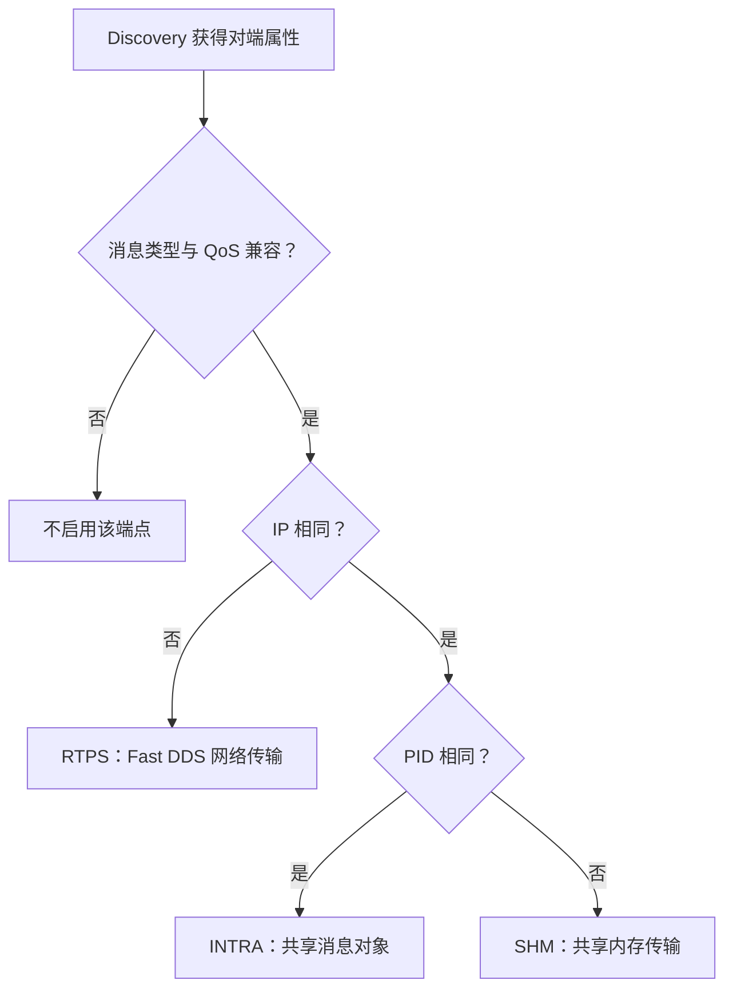

# MINI CyberRT

MINI CyberRT 是面向 Linux 的 C++ 发布订阅通信中间件，基于 [cmw](https://github.com/yanglianoo/cmw) 改进。
应用通过 Node（节点）创建 Publisher（发布者）和 Subscriber（订阅者），以 Channel（频道）组织消息收发。
运行时通过 Discovery（自动发现）维护端点关系，结合混合传输与协程调度，支持进程内及跨进程通信。

## 基于原项目的主要改进

原项目已提供 Node、Discovery、SHM（共享内存）/RTPS（实时发布订阅协议）通信和协程调度框架。
本项目的主要扩展与修复如下，对照基线为本仓库的 `v1.0-original` 标签：

| 方向 | 新增与改进 |
| --- | --- |
| 混合传输 | 新增 INTRA（进程内通信）和 HYBRID（混合传输），根据端点 IP 与 PID（进程标识符）自动选路。 |
| 共享内存零拷贝 | 新增 Loan（消息借用）与 View（只读），通过共享块和读写租约减少序列化与复制。 |
| 共享内存健壮性 | 修复 POSIX SHM 和跨进程布局问题，移除共享对象的虚表指针，补充 ABI（应用二进制接口）检查与引用关闭协议。 |
| Discovery 拓扑管理 | 接通端点发现与拓扑通知，支持晚加入进程发现和订阅者动态启停。 |
| QoS（服务质量） | 统一参数校验，落实有界历史、可靠性与持久性策略，区分业务消息和拓扑公告。 |
| 并发与调度 | 修复队列竞态、丢唤醒和协程状态同步，完善 CPU 亲和性与调度参数设置。 |
| 消息类型与序列化 | 增加消息类型标识，完善字段类型、长度检查和 RTPS 解码失败处理。 |
| 测试与工程入口 | 补充独立进程、动态拓扑和定向 sanitizer（运行时检查）回归，整理 SHM 性能程序、通信 Demo 及构建与日志目录。 |

## 快速开始

准备 Linux、g++、make 和 Fast DDS，在仓库根目录运行：

```bash
./example/demo/run_demo.sh
```

脚本会构建并演示进程内通信、跨进程共享内存、大消息 Loan/View、订阅者退出后重新加入，以及同机 RTPS 通信。
整套演示约 3 分钟，首次编译另计；成功时最后会输出 `[RESULT] PASS requested=all`。

脚本使用 `unshare` 创建独立 IPC 环境。依赖安装见[环境检查](doc/fastrtps.md)，
单场景运行和双终端操作见 [Demo 指南](example/demo/README.md)。

应用通过 Node 创建 Publisher/Subscriber，并为 Subscriber 注册消息回调。
自定义消息与完整示例见[消息与序列化](doc/serialize.md)。

<a id="功能与使用边界"></a>

## 主要功能

<a id="discovery-驱动的混合传输"></a>
<a id="自动发现和选择传输方式"></a>

### Discovery 与 HYBRID 混合传输

Discovery 按 Channel 维护发布订阅关系，HYBRID 根据端点 IP/PID 选择通信后端。
消息类型与 QoS 匹配后，按以下流程建立传输关系：



Node 默认使用 HYBRID，应用通过统一的 Publisher/Subscriber API 收发消息。
一个 Publisher 可以同时连接不同位置的 Subscriber，各通信后端随拓扑变化启停。
完整收发流程见[总体架构](doc/architecture.md)和[通信流程](doc/transport.md)。

<a id="loanedmessage-零拷贝"></a>
<a id="大消息减少拷贝loanview"></a>

### SHM Loan/View 零拷贝

面向图像、点云等大 Payload（消息数据），Publisher 通过 `AcquireMessage()` 获取
`LoanedMessage`（借用消息对象），填充数据后移交发布；Subscriber 接收只读 View。

读写 Lease（租约）按 RAII（资源获取即初始化）方式管理共享块生命周期，消息对象释放时自动归还资源。
纯 SHM 路径直接传递共享块，省去中间 Payload 序列化与复制；混合拓扑按后端需要进行复制或编码。
API 使用与拷贝范围见 [Demo 的 Loan/View 说明](example/demo/README.md#loanview-到底省了哪次拷贝)。

<a id="discovery-拓扑通知容量"></a>
<a id="discovery-后启动进程发现"></a>
<a id="discovery-发现与关闭"></a>
<a id="订阅者退出和重新加入"></a>

### Discovery 拓扑管理

Discovery 维护 Writer（发布端）和 Reader（订阅端）的 JOIN/LEAVE（加入/离开）通知，驱动 HYBRID 更新收发关系。
晚加入进程可从保留的拓扑公告发现在线 Writer，建立订阅后接收匹配后的新业务消息。

Publisher 持续运行期间，Subscriber 可以正常退出并重新加入，后端根据有效端点集合启停。
发现、匹配和退出流程见[发现与拓扑](doc/topology.md)。

<a id="消息类型与初始化失败"></a>
<a id="qos-配置与执行边界"></a>
<a id="序列化安全"></a>
<a id="消息定义和收发设置"></a>

### 消息类型与 QoS 配置

业务消息通过 `SERIALIZE(...)` 声明字段，可用 `MessageTypeTrait<T>`（消息类型声明）配置类型名称与版本。
`DataStream`（数据流编解码器）校验字段类型、长度和剩余数据，完整定义见[消息与序列化](doc/serialize.md)。

QoS 用于配置可靠性、持久性和历史策略。RTPS 默认采用 RELIABLE（可靠传输）与 VOLATILE（易失性），
保留 1 条传输历史；Subscriber 接收匹配后发布的新消息，待处理队列默认为 1 条。
参数与缓存配置见[端点配置](config/config.md#端点配置)。

创建 Node、Publisher 或 Subscriber 后检查返回值；创建失败时会返回空指针，业务代码可以据此处理错误。

<a id="发送端生命周期与并发边界"></a>
<a id="队列与线程调度同步"></a>
<a id="回调和资源管理"></a>

### 协程调度与生命周期管理

Subscriber 通过独立的待处理消息缓存衔接接收与回调，Scheduler（调度器）唤醒订阅协程执行用户代码。
发送端通过生命周期同步协调 Publish 与 Discovery 驱动的 Enable/Disable（启用/停用）。

每个 Publisher 由一个业务线程负责；关闭时先停止业务调用和回调，再释放节点及通信资源。
线程与协程的工作过程见[调度器](doc/scheduler.md)、[协程](doc/croutine.md)和[基础组件](base/base.md)。

<a id="shm-健壮性"></a>
<a id="共享区布局-v2-与兼容性"></a>
<a id="共享区布局-v3-与兼容性"></a>
<a id="notifier-槽位保护与丢弃策略"></a>
<a id="共享内存管理"></a>

### 共享内存与通知机制

Segment（共享内存段）管理映射，Block（消息块）保存 Payload，ConditionNotifier（共享内存通知器）发布可读通知。
接收端校验共享块状态后读取，Lease 保持映射及读写所有权，共享块随消息生命周期归还。

共享对象采用跨进程数据布局，打开时检查版本与 ABI，引用协议协调映射的挂接和释放。
当前 Payload 布局为 v3，SHM 单条消息上限为 32 MiB；参与通信的进程使用同一版本构建。
共享区与通知的实现见[通信流程](doc/transport.md#shm-中保存了什么)，运行环境和清理方法见[测试指南](example/TESTING.md#环境与清理)。

<a id="面试通信-demo"></a>
<a id="验证与展示范围"></a>
<a id="shm-性能比较边界"></a>

## 测试与性能

项目提供快速回归、集成回归和 A～E 通信 Demo，并提供 ASan（内存错误检查）、UBSan（未定义行为检查）、
TSan（数据竞争检查）的定向验证方式，覆盖消息收发、共享内存、动态拓扑和生命周期。
独立进程 SHM benchmark（性能基准测试）比较普通消息与 Loan 路径的有效吞吐和 CPU 开销。

运行命令与依赖见[测试指南](example/TESTING.md)，已经执行的结果见[测试日志](example/testlog.md)。
性能实验的测量方法和历史数据分别见[性能程序](example/TESTING.md#性能程序)与[实验概况](example/testlog.md#2026-09-11-独立进程-shm-性能实验)。

<a id="统一日志目录"></a>

## 构建和日志目录

| 内容 | 位置 |
| --- | --- |
| 普通示例、回归测试和性能程序的构建产物 | `example/build/` 及其子目录 |
| 通信 Demo 的构建产物 | `example/demo/build/` |
| 运行日志 | 根目录 `log/`；Demo 的逐轮归档见 [Demo 指南](example/demo/README.md#6-失败排查与清理) |

手动运行程序时，在仓库根目录设置配置路径：

```bash
export CMW_PATH="$PWD"
```

调用日志接口时提供文件名即可，Logger 会补齐 `.log` 后缀并写入日志目录。
`log/` 同时存放 Logger 源码，清理时保留源码；具体规则见 [AGENTS.md](AGENTS.md#日志文件归档)。

## 文档导航

| 阅读主题 | 文档入口 |
| --- | --- |
| 整体架构与消息流转 | [总体架构](doc/architecture.md)、[通信流程](doc/transport.md) |
| Discovery 与拓扑管理 | [发现与拓扑](doc/topology.md) |
| 消息定义与运行时配置 | [消息与序列化](doc/serialize.md)、[配置说明](config/config.md) |
| 调度、协程与基础组件 | [调度器](doc/scheduler.md)、[协程](doc/croutine.md)、[基础组件](base/base.md) |
| Demo、回归与性能实验 | [Demo 指南](example/demo/README.md)、[测试指南](example/TESTING.md) |
| 查看历史验证结果 | [测试日志](example/testlog.md) |
| 维护文档和目录 | [AGENTS.md](AGENTS.md) |

## 项目来源

原项目：[cmw](https://github.com/yanglianoo/cmw)。
[原作者视频](https://space.bilibili.com/281708692/lists/5849251?type=season) · [原作者讲解文档](https://ai.feishu.cn/drive/folder/PiqFfxWx5l9Ri2dds9WcI3ognCd?from=from_copylink)
